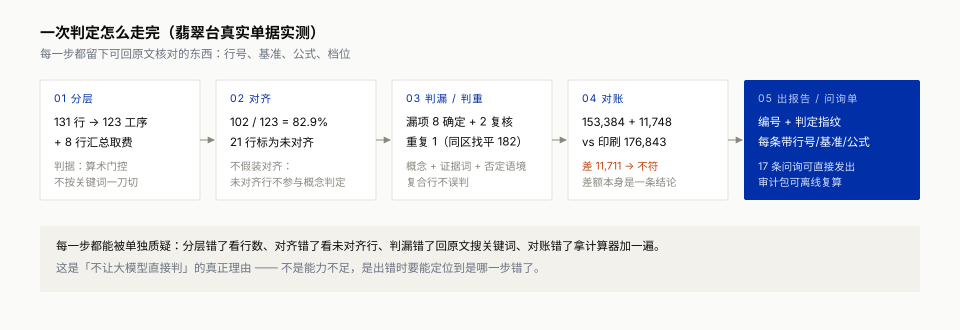

# 装明白 · 可计算审计（Computable Audit）

> 第十一届华为 ICT 大赛 · 中国创新赛 · 赛题 1「基于华为云产品打造 AI 创新应用」
>
> **装修报价的问题不是"看不懂"，是没有坐标系。我们给装修报价建了一套可计算的坐标系。**

签合同之前，上传 2–4 家装修公司的报价单（照片 / PDF / Excel），输出一份**可核对、可溯源、可复现**的审计报告：
谁漏了项、谁重复收了钱、谁口径混乱、补漏后真实成本是多少。

**边界**：不判断贵不贵（不做虚高/最低价断言），只判断漏没漏、重没重；低置信度结论不进核减金额，只进「待确认清单」。


---

## 架构原则：大模型只做理解与表达，判断交给规则

**四层，职责单一，可以分段验证**：

| 层 | 做什么 | 不做什么 |
|---|---|---|
| 感知层 | 把照片/PDF/Excel 变成行项 JSON，逐行做算术自校验 | 不判断对错 |
| 坐标系层 | 把「墙面批荡 / 刮腻子 / 批嵌」落到同一工序节点 | 不做结论 |
| 判断层 | 13 条规则跑漏项/重复/算术/对账/口径，每条带行号+基准+公式 | 不写文案 |
| 表达层 | 报告 / 问询单 / 审计包 / 校对台 | 不改判定 |

**为什么判断不经过大模型**：同一单跑两次，大模型会给两份不同的报告；规则引擎给同一份。
幻觉不是靠提示词压制的，是从架构上拿掉的。LLM 直读 vs 规则裁决的对照实验框架见 `eval/ab_llm_vs_rules.py`。

---

## 当前状态（2026-11-01）

| 模块 | 状态 |
|---|---|
| 审计引擎（分层 / 漏项 / 重复 / 算术 / 对账 / 口径 + 证据链） | ✅ `src/pipeline.py`（1,198 行，零第三方依赖） |
| 工序本体 | ✅ **119 概念 / 388 别名** / 8 大类 |
| 工序模板 | ✅ 老房翻新 39 项 / 新房毛坯 28 项 |
| 规则 DSL | ✅ **13 条**，全部可逐条审阅（`data/rules_v0.json`） |
| 感知层 | ✅ 四 provider：`file`（CSV/XLSX/PDF 零依赖）/ `maas`（Qwen-VL）/ `ocr_table`（华为云通用表格识别）/ `mock` |
| 真实单据评测 | ✅ **5 份 / 603 行工序明细 + 11 行汇总行**；两份完整黄金标注（含 not_applicable 三分类）；注入实验 197 例 |
| 单元测试 | ✅ **58 个全绿**（PDF 坐标 5 / 回归线 / 对账分层 9 / 四项创新 14 / 跨领域迁移 7） |
| 可打印报告 | ✅ `out/audit_report.html`（判定指纹上封面，打印级版式） |
| 解析校对台 | ✅ `web/review.html`（低置信度标黄 → 修改 → 导出 CSV） |
| **问询单** | ✅ 把结论变成可直接发给报价方的逐条问询（`src/inquiry.py`，17 条实测） |
| 输入兼容 | ✅ UTF-8 / **GBK** / UTF-16、逗号 / **TAB**、表头别名（项目/工程量/金额…） |
| 在线 Demo | ✅ `python3 -m uvicorn main:app --port 8000` |
| 离线演示包 | ✅ **106 文件 / 252KB**，干净目录可独立复现（含跨领域 demo） |
| RenoPit 对照实验 | 🚧 协议已预注册（`eval/对照实验协议_RenoPit.md`），跑批进行中 |
| 第二标注人 / 召回率 n>1 | 🚧 黄金标注机制就绪（`eval/golden_labels_TEMPLATE.csv`），待第二人 |

---

## 真实单据评测（不是 demo，是逐条回原文核实过的）

| # | 单据 | 性质 | 行数 | 对齐率 | 确定性漏项 | 重复 | 预测指纹 |
|---|---|---|---:|---:|---:|---:|---|
| 1 | 上海卓观 · 两房半包（篱笆网公开晒单） | 家装 · 照片转录 | 127 | 87.4% | 10（逐条核实 10/10） | 0（21 组变体正确排除） | `2ab9413a` |
| 2 | 花溪北岸 · 5 页施工报价 | 家装 · 照片转录 | 120 | 87.5% | 4（2 条曾被备注证据词救回） | 0 | `456e1bd9` |
| 3 | 深圳新新 · 诊所装饰（公开 PDF） | 工装 · 文本 PDF | 168 | 67.3% | 11（工装模板不适用，不作数） | 3 | `3d33c49c` |
| 4 | 上海翡翠台 · 老房全案 | 家装 · 照片转录 | 131 | 80.2% | 8/8 召回、8/10 精确（2 项为口径分歧） | 1（R2 同区，182 元） | 见 `eval/` |
| 5 | 124㎡ · 基础报价单（小红书公开晒单） | 家装 · 照片转录 | 65 | 95.4% | **范围内 4/4 召回、4/4 精确**（7 项 not_applicable） | 0 | 见 `eval/` |

**真实数据累计打穿 17 个缺陷**（篱笆 5 + 花溪 2 + 诊所 3 + 本体缺口 3 + 规则 2 + 表格识别 2），全部有单测或指纹锁定。

**2026-11-01 新增七项能力**（都从真实数据的问题长出来）：

| 能力 | 解决什么 |
|---|---|
| 汇总行分层 | 翡翠台 8 行汇总曾被当工序加总，单份算出 743,920 而非 176,843。判据是算术门控，不按关键词一刀切（诊所 19 行「…小计」是真工序） |
| 文档级对账 R13 | 整单加总 vs 印刷合计。实测抓出翡翠台 11,711 元、124㎡ 506.60 元差额；无印刷合计判「跳过」而非「对平」 |
| 同工序参照价库 | 单份上传没有同批参照时，退到 4 份家装单据的金额中位数；无样本的工艺项留空不编数 |
| **报价范围声明 → 模板裁剪** | 只报基础工程的单子，不该按全包口径要求主材。124㎡ 精确率 0.22 → 0.67 |
| **审计包 + 离线校验器** | 45KB 的包，任何人 `python3 verify.py` 30 秒复算；改一个数字立即 FAIL |
| **计价体系识别** | 先认「工程量清单 / 按面积 / 套餐 / 汇总列表」，再决定怎么读、提示什么 |
| **条款 → 义务 → 验收证据** | 把「按实结算/暂定/另计」翻译成「签约前必须问什么、验收要留什么凭证」 |
| **跨领域迁移** | 引擎零改动，只换本体/模板/覆盖率三份 JSON，同一套 13 条规则可审汽修维保单（`data/repair/` + `scripts/audit_with.py`） |

### 换个行业还能用吗（迁移实验）

能，而且是**跑出来的**，不是「理论上可以」：

```bash
python3 scripts/audit_with.py \
  --ontology data/repair/ontology_repair.json \
  --templates data/repair/templates_repair.json --template major_service \
  --coverage data/repair/coverage_repair.json \
  --csv data/repair/sample_major_service.csv --out out/repair
```

| 换什么 | 装修 | 汽修 |
|---|---|---|
| 本体 | 119 概念 / 388 别名 | 40 概念 / 97 别名 |
| 模板 | 老房 39 / 新房 28 | 大保养 18 / 小保养 8 |
| 规则 | 13 条 | **同一份，原样复用** |
| 引擎代码 | `src/pipeline.py` | **同一个文件，零改动** |

实测：对齐 19/19、漏项 4、重复 1、算术 1、对账差 30 元、开口条款 2 类，报告版式自动继承。

> 迁移实验顺带抓出两处「只在自己领域成立」的假设（R6 直接取 `onto["u"]`、报告函数假设
> `_cross_unit` 存在），已修并锁进 `tests/test_migration.py`。
> **「可迁移」不是形容词，是 7 个测试用例。**



> 判断凭什么可信：见 [`docs/判断正确性如何保证.md`](docs/判断正确性如何保证.md)。核心是四条——
> 只判可判定的命题、每条结论带行号/基准/公式、真值来自四路独立来源、任何人可拿审计包离线复算。
四份单据的详细评测在 `docs/` 与校赛材料（含逐条核实过程、黄金标注、混淆矩阵）。

**诚实边界**：n=5，只作存在性证明；第 4、5 份有完整黄金标注（单一标注者 A1）；
照片单据为人工转录，非 VLM——这正是必须接感知层的实证理由。

---

## 快速开始

### 1. 离线跑（零依赖，不需要云服务 / 网络）

```bash
cd zhuangmingbai
bash run_offline.sh                   # 合成三单 → out/audit_report.html
python3 -m unittest discover -s tests # 58 个用例
```

### 2. 在线 Demo

```bash
python3 -m pip install -r requirements.txt
python3 -m uvicorn main:app --port 8000
# 打开 http://127.0.0.1:8000  → 上传 2-4 份 CSV/XLSX → 审计
```

### 3. 真实单据 + 指纹复现

```bash
python3 scripts/snapshot_predictions.py --check   # 三份冻结指纹比对
python3 eval/eval_alignment.py                    # 覆盖率（60 项目名口径 83.3%）
```

### 4. 照片 / PDF 解析（需开通云服务）

```bash
# 方案 A：华为云「文字识别 OCR → 通用表格识别」（用 AK/SK，有免费额度）
export HW_AK=... HW_SK=... HW_REGION=cn-north-4
python3 scripts/parse_doc.py 报价单照片.jpg --provider ocr_table

# 方案 B：ModelArts Studio（MaaS）Qwen-VL（照片首选，能处理手写/合并单元格）
export MAAS_API_KEY=...
python3 scripts/parse_doc.py 报价单照片.jpg --provider maas

# PDF（含文本层）零依赖，不需要任何云服务
python3 scripts/parse_doc.py 报价单.pdf
```

---

## 仓库结构

```
src/pipeline.py         审计引擎（本体对齐 / 12 规则 / 证据链 / 报告生成）
src/perception.py       感知层四 provider（file / maas / ocr_table / mock）
main.py                 FastAPI 在线 Demo（/ 上传 /review 校对台 /real 真实单据）
web/review.html         解析校对台（低置信度标黄 → 改 → 导出 CSV）
data/ontology_v0.json   工序本体 119 概念 / 386 别名
data/templates_v0.json  老房 39 项 / 新房 28 项
data/rules_v0.json      12 条审计规则
data/coverage_v0.json   33 组证据词 + 父类吸收表
data/real/              5 份真实单据（公开晒单/公开 PDF 的人工转录，无个人信息）
eval/                   可复现评测：冻结指纹 / 混淆矩阵 / 黄金标注 / 对照实验协议 / A-B 框架
tests/                  58 个单元测试（含回归线：400 / 22,164 / 3,168）
scripts/                感知层 CLI / 指纹快照 / 离线包构建
docs/                   评测报告 / 部署手册 / 缺陷登记册 / 感知层接入说明
```

---

## 样例跑出来的结果（引擎自测，合成三单）

| 公司 | 报价总价 | 漏项补项 | 重复剔除 | 真实成本 | 风险敞口 |
|---|---:|---:|---:|---:|---|
| A 规范型 | 86,498 | 400 | 0 | 86,898 | — |
| B 低价引流型 | 59,902 | 22,164（17 项） | 0 | 82,066 | 6,100–7,300 |
| C 高价项全型 | 100,146 | 0 | 3,168（2 项） | 96,978 | — |

**演示结论**：B 表面最低，补漏后 82,066，加上水电按实结算敞口 6,100–7,300 → 88,166–89,366，反超 A 的 86,898。最低价不等于最低成本。

> 合成样例（`data/samples/`）是按真实晒单结构合成的自测样本，**不是真实业主单据**，不得作为"真实数据"对外宣称。

---

## 数据合规

- 真实单据全部来自**公开晒单 / 公开 PDF**，或业主授权提供；仓库内 CSV 已扫描确认**无手机号、身份证、姓名称谓**
- 原始照片不进入仓库；转录 CSV 保留金额与工序结构（审计所需），不含个人信息
- 全站定位「计费核对与信息整理工具」：**非定价鉴定、非法律意见、非施工验收**

---

## License

MIT（见 `LICENSE`）。数据文件（`data/`）仅用于评测与研究，转载原始单据需遵守来源平台条款。

---

## 相关

- 对照基准：[RenoPit / 装闭](https://github.com/fthux/RenoPit)（LLM 直读批判路线，对照实验协议见 `eval/`）
- 华为云产品：CodeArts（开发全过程五环节留痕）· ModelArts Studio（MaaS Qwen-VL）· 文字识别 OCR · RDS PostgreSQL · OBS
